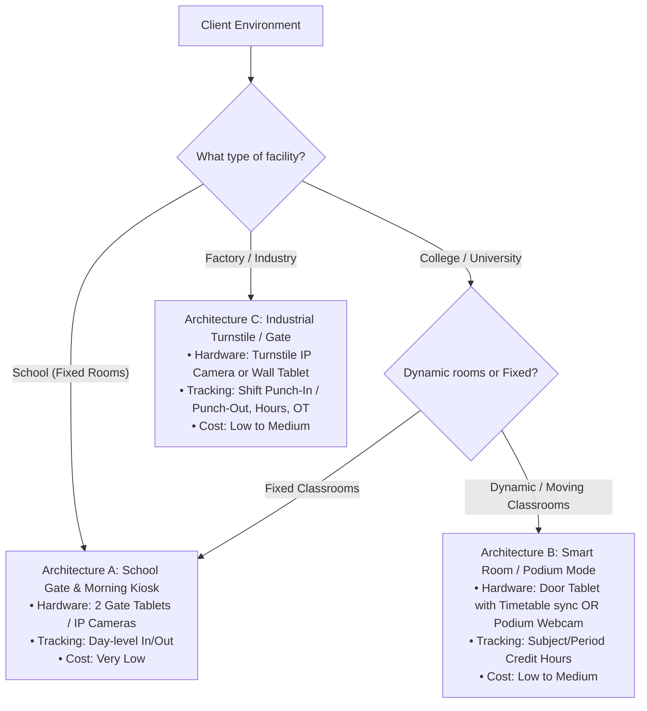

# Client Requirements Gathering & Architecture Selection Template

> **Purpose:** Use this questionnaire and architecture matrix during initial client discovery meetings (colleges, universities, schools, and factories) to understand their operational environment and recommend the exact camera placement, hardware setup, and data flow.

---

## Part 1: Client Discovery Questionnaire

### 1. General Profile
* **Client Name:** ___________________________________________
* **Client Type:** 
  - [ ] School (K-12)
  - [ ] College / University
  - [ ] Manufacturing Plant / Factory
  - [ ] Corporate Office
* **Total Headcount:** 
  - Students / Workers: ___________
  - Teachers / Staff: ___________
* **Number of Locations / Buildings:** ___________

---

### 2. Operational & Scheduling Model
* **For Educational Institutions:**
  - [ ] **Fixed Classrooms** (Students stay in one room all day; teachers rotate)
  - [ ] **Dynamic Classrooms / Credit Hours** (Students and teachers move between lecture halls and labs each period)
  - Period Duration: [ ] 45 min  [ ] 50 min  [ ] 60 min  [ ] Other: ______
  - Are there elective / cross-department subjects? [ ] Yes  [ ] No
* **For Industrial & Commercial Plants:**
  - Number of Shifts: [ ] 1  [ ] 2  [ ] 3 (24/7)
  - Shift Timings: Shift 1: ______ | Shift 2: ______ | Shift 3: ______
  - Do shifts cross midnight? [ ] Yes  [ ] No
  - Break times tracked? [ ] Yes  [ ] No
  - Overtime calculation needed? [ ] Yes  [ ] No

---

### 3. Existing Infrastructure & Network
* **Network Availability:**
  - Local Wi-Fi coverage in halls/gates? [ ] Yes  [ ] No  [ ] Partial
  - Wired Ethernet (LAN) ports near entrances/classrooms? [ ] Yes  [ ] No
  - Central IT Server Room with dedicated PC/Server available? [ ] Yes  [ ] No
* **Existing Cameras:**
  - Are there existing CCTV cameras at gates or halls? [ ] Yes  [ ] No
  - Camera Brand / Type: [ ] Hikvision  [ ] Dahua  [ ] Uniview  [ ] CP Plus  [ ] Other: ______
  - Do they support RTSP? [ ] Yes  [ ] Unsure
  - Are camera angles at eye-level or high ceiling? [ ] Eye-level  [ ] High Ceiling
* **Teacher / Gate Devices:**
  - Does each classroom have a podium PC? [ ] Yes  [ ] No
  - Are teachers issued laptops/tablets? [ ] Yes  [ ] No
  - Can tablets be wall-mounted at doors or turnstiles? [ ] Yes  [ ] No

---

### 4. Software & Integration Requirements
* **Existing LMS / ERP / SIS System:**
  - Name of current system: [ ] Moodle  [ ] Canvas  [ ] Blackboard  [ ] Custom ERP  [ ] Excel only  [ ] Other: ______
  - Can they export Student / Course data as Excel/CSV? [ ] Yes  [ ] No
  - Do they require attendance to sync back to their LMS? [ ] Yes  [ ] No
* **Reporting & Notifications:**
  - [ ] Student / Parent Self-Service Web Portal (Login via Roll No & DOB)
  - [ ] Automated Weekly Defaulter PDF (<75% attendance)
  - [ ] Industrial Muster Roll Excel for Payroll (Present/Absent/OT hours)
  - [ ] Administrative Audit Logs

---

## Part 2: Architecture Selection & Camera Placement Matrix

Based on the client's answers above, identify their category below and propose the corresponding architecture:

---

### Architecture A: Schools & Fixed-Classroom Colleges

* **Primary Challenge:** High volume of students arriving in a short window (07:45 – 08:15 AM).
* **Recommended Placement:**
  1. **Main Entrance Turnstile / Gate Kiosk:**
     - 2 to 4 wall-mounted 10-inch Android tablets or eye-level RTSP cameras mounted directly at the pedestrian gates.
     - Fast walk-by recognition (<400ms per face).
  2. **Alternative (Classroom Podium):**
     - Single tablet on the class teacher's desk. Students glance once as they enter in the morning.
* **Software Configuration:**
  - Single daily attendance session per student.
  - Automated cutoff time (e.g., Late after 08:15 AM, Absent after 08:45 AM).

---

### Architecture B: Universities & Colleges (Dynamic Rooms)

* **Primary Challenge:** Both students and professors switch rooms every period. Gate cameras cannot prove lecture attendance.
* **Option B1 — The "Smart Room" Door Tablet (Recommended for Modern Campuses):**
  - **Hardware:** 8-inch budget Android tablet mounted in an anti-theft wall bracket beside each lecture hall door.
  - **Logic:** Tablet is tied to `Room ID`. The timetable automatically rotates courses (e.g., Room 102 switches from Math at 09:00 to Physics at 10:00).
  - **Student Experience:** Walk up to the door, glance at the screen for 1 second, hear confirmation beep, enter room.
* **Option B2 — The Teacher Podium Webcam (Zero Extra Hardware Cost):**
  - **Hardware:** A standard \$15 wide-angle USB webcam connected to the existing podium computer or teacher's laptop.
  - **Logic:** Teacher opens browser, clicks "Start Attendance Session" for the first 5 minutes of class. Students step past the podium as they walk in.
  - **Student Experience:** Fast and frictionless; no expensive wall hardware needed.

---

### Architecture C: Industrial Plants & Factories

* **Primary Challenge:** Multiple rotating shifts, high dust/factory conditions, shift overtime, lunch breaks.
* **Recommended Placement:**
  1. **Turnstile / Security Guard Booth:**
     - Heavy-duty IP Camera or rugged industrial tablet mounted at eye level along the entry/exit turnstile lanes.
     - Lane 1: **IN** camera (records Shift Check-In).
     - Lane 2: **OUT** camera (records Shift Check-Out).
* **Software Configuration:**
  - Shift engine: Maps punch time to assigned shift (e.g., Shift A: 06:00–14:00, Shift B: 14:00–22:00, Shift C: 22:00–06:00).
  - Overtime calculation: Automatically flags early arrivals, late departures, and calculates net overtime hours.
  - Monthly Muster Roll export formatted for factory HR/Payroll.

---

## Part 3: Architecture Proposal Summary Sheet
*(Hand this page or include in your formal proposal to the client)*

| Parameter | Recommended Specification |
| :--- | :--- |
| **System Architecture** | On-Premise Local Server (Node.js + MongoDB container) |
| **Server Hardware** | Intel Core i5 / i7 (8th Gen+), 16GB RAM, 512GB SSD |
| **Terminal Hardware** | 10" Android Tablets (Eye-level wall mount) OR PoE IP Cameras (Hikvision/Dahua) |
| **Network Protocol** | Gigabit Local LAN / 5GHz Wi-Fi (No external internet required for scanning) |
| **Biometric Privacy** | Local Storage Only; 128-dimensional mathematical vectors (Zero raw photos stored) |
| **Integration Method** | One-Click Excel/CSV Enrollment Sync + Direct LMS Gradebook Export |
| **Reporting Output** | Automated Weekly Defaulter PDFs (<75%) + Monthly Master Excel Sheets |
